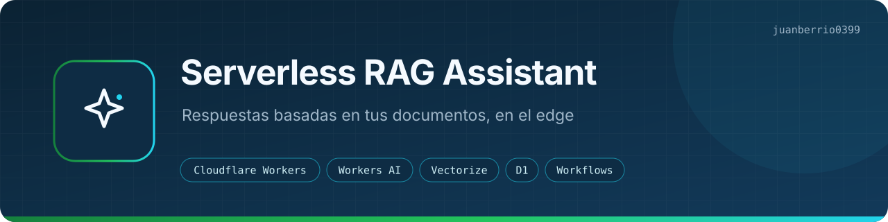
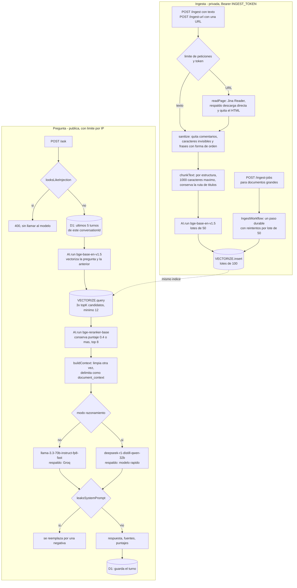

<p align="center"></p>
<p align="center"><a href="README.md">English</a> · <b>Español</b></p>
<p><b>Qué hace:</b> le das un texto o una URL y responde preguntas sobre ese contenido, dice de qué documento salió cada respuesta y responde "no sé" cuando la respuesta no está ahí.</p>
<p><b>Cómo funciona:</b> un solo Worker de Cloudflare parte los documentos en fragmentos y los guarda como embeddings en Vectorize con Workers AI; ante una pregunta recupera, reordena con un cross-encoder y Llama 3.3 (o DeepSeek-R1 en modo razonamiento) responde solo con esos fragmentos. La memoria de la conversación queda en D1.</p>
<p><a href="https://github.com/juanberrio0399/serverless-rag-assistant/actions/workflows/test.yml"></a> <a href="https://github.com/juanberrio0399/serverless-rag-assistant/actions/workflows/codeql.yml"></a> <a href="LICENSE"></a> <a href="https://serverless-rag-assistant.tienvo.workers.dev">Demo en vivo</a></p>

---

## El problema

A un LLM le preguntas por un documento privado y o se niega o se lo inventa, porque ese documento nunca estuvo en su entrenamiento. La Generación Aumentada por Recuperación (RAG) lo resuelve: primero busca los fragmentos relevantes y después se los pone al modelo enfrente.

Lo armé como un solo Worker para ver hasta dónde da el plan gratuito de Cloudflare (10.000 neuronas de Workers AI al día, un índice de Vectorize, una base D1). Dos cosas lo hacen más que una demo. La recuperación es de dos etapas, así que un corpus ruidoso no mete el fragmento equivocado en el prompt. Y todo documento que entra se trata como entrada hostil: una página puede traer instrucciones dirigidas al modelo, y `src/guard.js` las quita antes de que lleguen al índice.

## Cómo funciona

Dos caminos comparten el mismo índice. La ingesta es privada (token Bearer); preguntar es público y con límite de peticiones.



El reranker se gana la llamada extra: Vectorize devuelve similitud vectorial aproximada, buena en cobertura y mediocre en precisión. Traer el triple de lo que el prompt necesita y dejar que un cross-encoder puntúe cada par pregunta-fragmento es lo que mantiene un fragmento fuera de tema lejos del contexto. Si la llamada al reranker falla, se usa el orden original de similitud y la petición responde igual.

La fragmentación es estructural, no de tamaño fijo. El texto se parte en títulos, párrafos, viñetas, filas de tabla, bloques de código y oraciones, y esas piezas se empacan en fragmentos de máximo 1000 caracteres con un solapamiento de oraciones completas. Cada fragmento empieza con su ruta de títulos (`# Página > Sección`), de modo que un fragmento recuperado dice de qué habla. Medido sobre seis páginas reales de documentación de Cloudflare: 377-586 caracteres por fragmento, 487 en conjunto. Contra el corte de tamaño fijo sobre las tres páginas de `tests/fixtures/`, los fragmentos que empezaban a mitad de oración pasaron de 13/16 a 0, las palabras partidas entre dos fragmentos de 10 a 0 y los fragmentos que mezclaban dos secciones de 11 a 0, con 10% más de caracteres indexados. `npm run test:unit` imprime la tabla.

La lista de endpoints, los dos modos de respuesta, las cuatro capas contra inyección de prompts con sus resultados medidos, la memoria de conversación, ejemplos de uso de la API, las decisiones de diseño y la guía de operación están en **[docs/reference.es.md](docs/reference.es.md)**.

Historias de usuario, flujos y datos: [docs/PRODUCTO.md](docs/PRODUCTO.md).

## Con qué se conecta

| Repo o sistema | Cómo |
|---|---|
| [juanberrio0399.github.io](https://github.com/juanberrio0399/juanberrio0399.github.io) | Mi sitio de portafolio tiene su tarjeta de proyecto y enlaza la demo en vivo |
| Cloudflare Workers AI, Vectorize, D1, Workflows | Los bindings del Worker, todos declarados en `wrangler.jsonc` |
| Jina Reader | Convierte una URL en Markdown antes de ingerirla; si falla, el Worker descarga la página por su cuenta |
| Groq (opcional) | Respaldo para responder cuando Workers AI se queda sin cuota, solo si existe `GROQ_API_KEY` |
| Terraform | Aprovisiona un bucket R2 para los documentos originales. El Worker todavía no lo usa |

## Cómo correrlo

```bash
npm ci
npm test                 # suite unitaria + suite de runtime
npm run test:unit        # node:test con bindings falsos
npm run test:workers     # Vitest dentro de workerd
npm run dev              # wrangler dev --remote (requiere cuenta de Cloudflare)
npm run deploy           # wrangler deploy
```

Ninguna de las dos suites toca una cuenta de Cloudflare ni necesita credenciales.

Primer despliegue, una vez por cuenta:

```bash
npx wrangler vectorize create rag-index --preset @cf/baai/bge-base-en-v1.5
npx wrangler d1 create rag-memory          # pega el database_id que devuelve en wrangler.jsonc
npx wrangler d1 migrations apply rag-memory --remote
npx wrangler secret put INGEST_TOKEN       # sin esto, la ingesta responde 503
npx wrangler deploy
```

Secretos, solo por nombre — ninguno va en `wrangler.jsonc`:

| Secreto | Obligatorio | Qué pasa si falta |
|---|---|---|
| `INGEST_TOKEN` | sí, para ingestar | Todos los endpoints de ingesta responden `503` (falla cerrado) |
| `JINA_API_KEY` | no | Jina Reader limita por IP y las IPs de salida de Cloudflare son compartidas, así que `429 Per IP rate limit exceeded` es común; una llave gratis sube el límite |
| `GROQ_API_KEY` | no | Sin respaldo cuando Workers AI se queda sin cuota o falla; `/ask` devuelve respuesta vacía con un campo `error` |

## Estructura

| Ruta | Qué vive ahí |
|---|---|
| `src/worker.js` | Punto de entrada declarado en `wrangler.jsonc`: reexporta el handler HTTP y la clase del Workflow |
| `src/index.js` | Rutas y el pipeline de `/ask`: límite de peticiones, revisión de inyección, memoria, embedding, recuperación, rerank, respuesta |
| `src/ingest.js` | Utilidades de ingesta: validación de URL (sin rangos privados), Jina Reader con respaldo de descarga directa, embedding e inserción por lotes, comparación del token en tiempo constante, rate limiter |
| `src/ingest-jobs.js` | Validación de la petición, plan de lotes y el paso embed/upsert que usa el Workflow |
| `src/workflow.js` | `IngestWorkflow`: un paso durable con reintentos por lote de 50 fragmentos |
| `src/chunker.js` | Fragmentación por estructura (títulos, párrafos, listas, tablas, bloques de código, oraciones) |
| `src/guard.js` | Detección de inyecciones, limpieza, delimitación del contexto, prompt de sistema, revisión de fuga |
| `src/memory.js` | Memoria de conversación en D1: carga, guardado, retención, reescritura de la consulta de recuperación |
| `src/reasoning.js` | Modo DeepSeek-R1: forma del prompt, lectura de `<think>`, manejo de fallos |
| `migrations/` | Esquema de D1, aplicado con `wrangler d1 migrations apply` |
| `tests/*.test.js` | Suite unitaria con `node:test` y bindings falsos |
| `tests/workers/*.spec.js` | Suite de Vitest que corre dentro de workerd con los bindings reales |
| `tests/fixtures/` | Extractos de tres páginas de documentación de Cloudflare (CC BY 4.0) para medir fragmentación y falsos positivos |
| `terraform/` | El bucket R2 para los documentos originales, gestionado con Terraform. Todavía no conectado al Worker |
| `wrangler.jsonc` | Todos los bindings que usa el Worker. Cambiar este archivo es cambiar la infraestructura |
| `.github/workflows/` | `test.yml` (las dos suites) y `codeql.yml` (SAST) |
| `docs/` | Referencia (API, defensas, decisiones, operación), documento de producto (historias, flujos, datos) y los banners |

## Estado

En vivo en <https://serverless-rag-assistant.tienvo.workers.dev>. Hoy funcionan las dos rutas de ingesta, la recuperación con rerank, los dos modos de respuesta con respaldo, las cuatro capas contra inyección, la memoria en D1, el límite por IP, la página demo bilingüe y las dos suites de pruebas en CI.

A medio hacer: `terraform/` aprovisiona un bucket R2 que el Worker no usa, los despliegues son un `wrangler deploy` local (así que el Worker en vivo y `main` pueden desalinearse) y el `database_id` de `wrangler.jsonc` es de mi cuenta, así que un fork tiene que cambiarlo.

Lo siguiente, de los issues abiertos: [#74 AI Gateway](https://github.com/juanberrio0399/serverless-rag-assistant/issues/74) (caché y observabilidad por modelo para las hasta tres llamadas por pregunta), [#80 respuestas en streaming por SSE](https://github.com/juanberrio0399/serverless-rag-assistant/issues/80) y [#81 filtrado por metadatos en Vectorize](https://github.com/juanberrio0399/serverless-rag-assistant/issues/81). Más detalle en [PLAN.md](PLAN.md) (en inglés).

## Mantenimiento

Las dependencias las mantiene al día Dependabot, que configuré yo en [`.github/dependabot.yml`](.github/dependabot.yml). Cada PR que abre me lo asigna a mí con la etiqueta `mantenimiento-automatico`, solo entra si pasan las pruebas y los cambios de versión mayor los reviso a mano.

## Licencia

[MIT](LICENSE) · Juan Berrio · [juanberrio0399.github.io](https://juanberrio0399.github.io)
