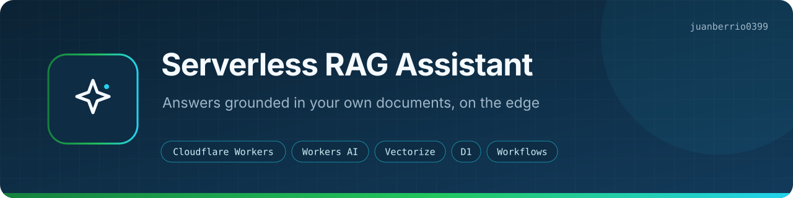
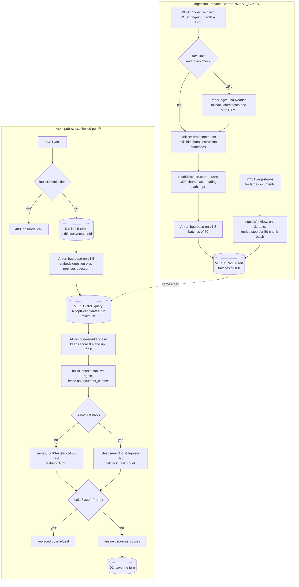

<p align="center"></p>
<p align="center"><b>English</b> · <a href="README.es.md">Español</a></p>
<p><b>What it does:</b> you give it text or a URL, and it answers questions about that content, says which document each answer came from, and says "I don't know" when the answer isn't there.</p>
<p><b>How it works:</b> one Cloudflare Worker chunks and embeds the documents into Vectorize with Workers AI; on a question it retrieves, reranks with a cross-encoder and has Llama 3.3 (or DeepSeek-R1 in reasoning mode) answer from those chunks only. Conversation memory lives in D1.</p>
<p><a href="https://github.com/juanberrio0399/serverless-rag-assistant/actions/workflows/test.yml"></a> <a href="https://github.com/juanberrio0399/serverless-rag-assistant/actions/workflows/codeql.yml"></a> <a href="LICENSE"></a> <a href="https://serverless-rag-assistant.tienvo.workers.dev">Live demo</a></p>

---

## The problem

Ask an LLM about a private document and it either refuses or makes something up, because that document was never in its training data. Retrieval-Augmented Generation fixes that: find the relevant fragments first, then put them in front of the model.

I built it as a single Worker to see how far the Cloudflare free tier goes (10,000 Workers AI neurons a day, one Vectorize index, one D1 database). Two things make it more than a demo. Retrieval is two-stage, so a noisy corpus doesn't drag the wrong chunk into the prompt. And every ingested document is treated as hostile input: a page can carry instructions aimed at the model, and `src/guard.js` strips them before they reach the index.

## How it works

Two paths share the same index. Ingestion is private (Bearer token); asking is public and rate limited.



The reranker earns its extra call: Vectorize returns approximate vector similarity, which is good at recall and mediocre at precision. Over-retrieving three times what the prompt needs and letting a cross-encoder score each query-chunk pair directly is what keeps an off-topic fragment out of the context. If the reranker call fails, the original similarity order is used and the request still answers.

Chunking is structural, not fixed-size. The text is split into headings, paragraphs, list items, table rows, fenced code and sentences, and those units are packed into chunks of at most 1000 characters with a whole-sentence overlap. Each chunk starts with its heading path (`# Page > Section`), so a retrieved fragment states what it is about. Measured over six real Cloudflare documentation pages: 377-586 characters per chunk, 487 overall. Against fixed-size cutting on the three fixtures in `tests/fixtures/`, chunks starting mid-sentence went from 13/16 to 0, words split across two chunks from 10 to 0, and chunks mixing two sections from 11 to 0, for 10% more indexed characters. `npm run test:unit` prints the table.

The endpoint list, the two answering modes, the four prompt-injection layers with their measured results, the conversation memory, API examples, design decisions and the runbook are in **[docs/reference.md](docs/reference.md)**.

User stories, flows and data: [docs/PRODUCT.md](docs/PRODUCT.md).

## What it connects to

| Repo or system | How |
|---|---|
| [juanberrio0399.github.io](https://github.com/juanberrio0399/juanberrio0399.github.io) | My portfolio site has a project card for it and links the live demo |
| Cloudflare Workers AI, Vectorize, D1, Workflows | The Worker's bindings, all declared in `wrangler.jsonc` |
| Jina Reader | Turns a URL into Markdown before ingesting; if it fails, the Worker fetches the page itself |
| Groq (optional) | Fallback for answers when Workers AI is out of quota, only if `GROQ_API_KEY` is set |
| Terraform | Provisions an R2 bucket for source documents. The Worker doesn't use it yet |

## How to run it

```bash
npm ci
npm test                 # unit suite + runtime suite
npm run test:unit        # node:test with fake bindings
npm run test:workers     # Vitest inside workerd
npm run dev              # wrangler dev --remote (needs a Cloudflare account)
npm run deploy           # wrangler deploy
```

Neither test suite touches a Cloudflare account or needs credentials.

First deploy, once per account:

```bash
npx wrangler vectorize create rag-index --preset @cf/baai/bge-base-en-v1.5
npx wrangler d1 create rag-memory          # paste the returned database_id into wrangler.jsonc
npx wrangler d1 migrations apply rag-memory --remote
npx wrangler secret put INGEST_TOKEN       # without it, ingestion answers 503
npx wrangler deploy
```

Secrets, by name only — none of them belong in `wrangler.jsonc`:

| Secret | Required | Effect if absent |
|---|---|---|
| `INGEST_TOKEN` | yes, to ingest | All ingestion endpoints answer `503` (fails closed) |
| `JINA_API_KEY` | no | Jina Reader rate limits per IP and Cloudflare egress IPs are shared, so `429 Per IP rate limit exceeded` is common; a free key raises the limit |
| `GROQ_API_KEY` | no | No fallback when Workers AI is out of quota or failing; `/ask` returns an empty answer with an error field |

## Structure

| Path | What lives there |
|---|---|
| `src/worker.js` | Worker entry point declared in `wrangler.jsonc`: re-exports the HTTP handler and the Workflow class |
| `src/index.js` | Routing and the `/ask` pipeline: rate limit, injection check, memory, embed, retrieve, rerank, answer |
| `src/ingest.js` | Ingestion helpers: URL validation (no private ranges), Jina Reader + direct-fetch fallback, batched embed and insert, constant-time token check, rate limiter |
| `src/ingest-jobs.js` | Request parsing, batch planning and the per-batch embed/upsert used by the Workflow |
| `src/workflow.js` | `IngestWorkflow`: one durable, retried step per 50-chunk batch |
| `src/chunker.js` | Structure-aware chunking (headings, paragraphs, lists, tables, code fences, sentences) |
| `src/guard.js` | Injection detection, sanitizing, context fencing, system prompt, answer leak check |
| `src/memory.js` | D1 conversation memory: load, save, retention, retrieval-query rewriting |
| `src/reasoning.js` | DeepSeek-R1 mode: prompt shape, `<think>` parsing, failure handling |
| `migrations/` | D1 schema, applied with `wrangler d1 migrations apply` |
| `tests/*.test.js` | `node:test` unit suite with fake bindings |
| `tests/workers/*.spec.js` | Vitest suite running inside workerd with the real bindings |
| `tests/fixtures/` | Excerpts of three Cloudflare documentation pages (CC BY 4.0) used to measure chunking and false positives |
| `terraform/` | The R2 bucket for original documents, managed with Terraform. Not wired into the Worker yet |
| `wrangler.jsonc` | Every binding the Worker uses. Changing this file changes the infrastructure |
| `.github/workflows/` | `test.yml` (both suites) and `codeql.yml` (SAST) |
| `docs/` | Reference (API, defences, decisions, operation), product doc (user stories, flows, data) and the banners |

## Status

Live at <https://serverless-rag-assistant.tienvo.workers.dev>. Both ingestion paths, reranked retrieval, both answering modes with fallbacks, the four injection layers, D1 memory, per-IP rate limiting, the bilingual demo page and both test suites in CI work today.

Still half-done: `terraform/` provisions an R2 bucket the Worker doesn't use, deploys are a local `wrangler deploy` (so the live Worker and `main` can drift), and the `database_id` in `wrangler.jsonc` belongs to my account, so a fork has to replace it.

Next, from the open issues: [#74 AI Gateway](https://github.com/juanberrio0399/serverless-rag-assistant/issues/74) (cache and per-model observability for the up-to-three model calls per question), [#80 streaming answers over SSE](https://github.com/juanberrio0399/serverless-rag-assistant/issues/80) and [#81 metadata filtering in Vectorize](https://github.com/juanberrio0399/serverless-rag-assistant/issues/81). More detail in [PLAN.md](PLAN.md).

## Maintenance

Dependencies are kept current by Dependabot, which I set up in [`.github/dependabot.yml`](.github/dependabot.yml). Every PR it opens is assigned to me with the `mantenimiento-automatico` label, it only gets merged if the tests pass, and I review major version bumps by hand.

## License

[MIT](LICENSE) · Juan Berrio · [juanberrio0399.github.io](https://juanberrio0399.github.io)
