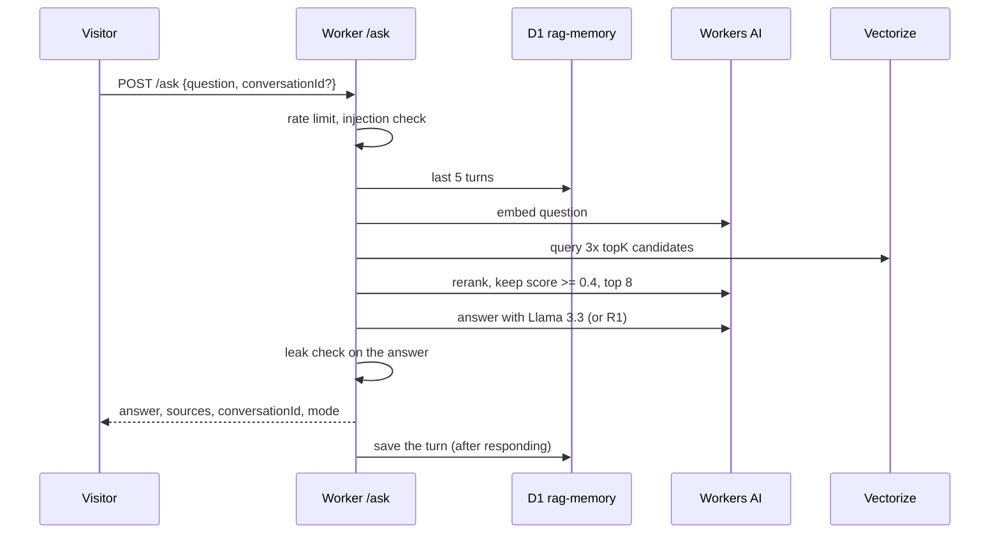
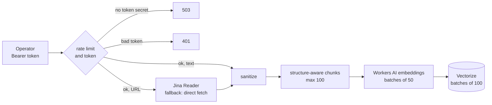
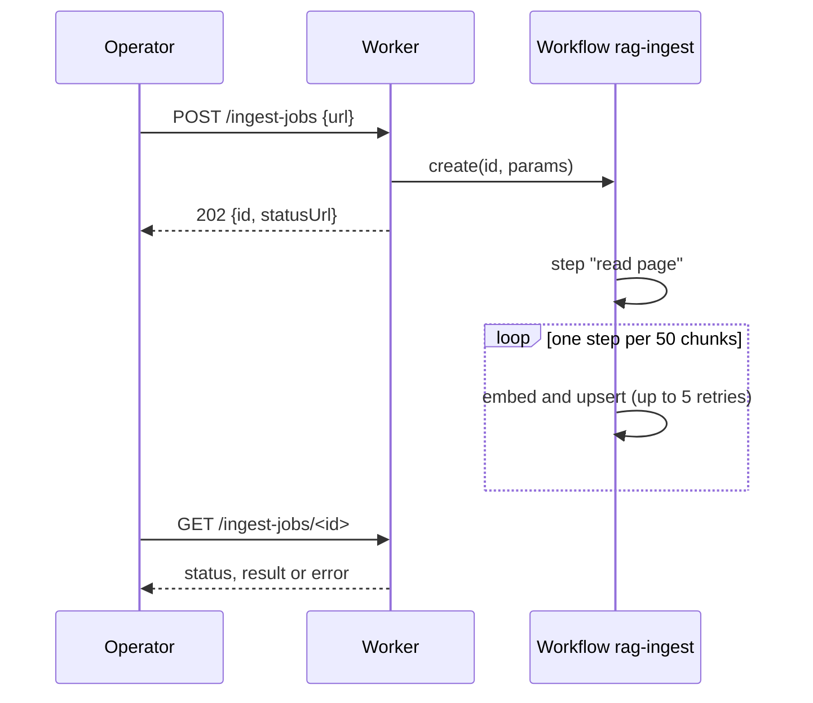
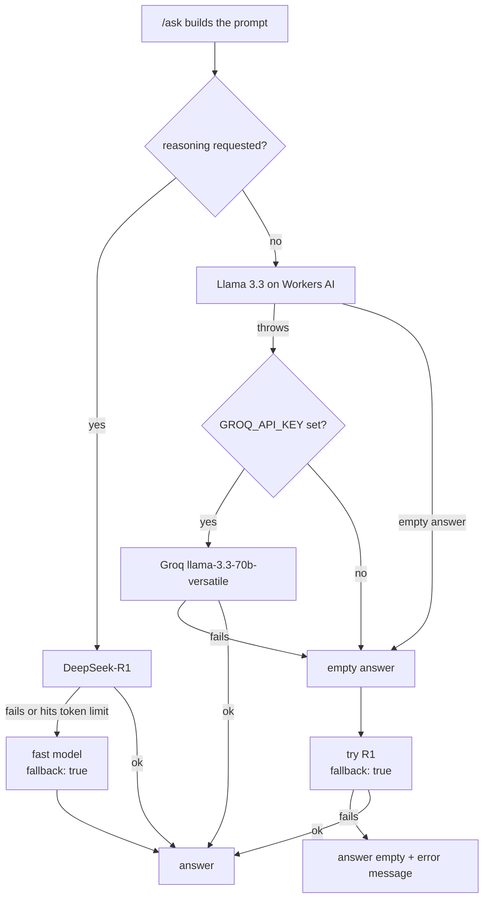
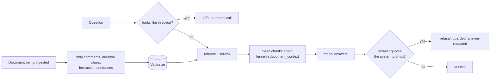
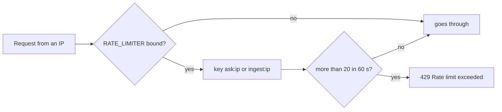
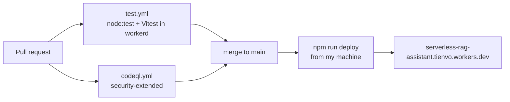

<a href="PRODUCTO.md">Español</a> · <b>English</b>

# Serverless RAG Assistant as a product

User stories, flows and data. How each piece is built is in the [README](../README.md) and the [reference](reference.md).

## Who it's for

| Level | Who | What they need |
|---|---|---|
| External | A visitor, often a recruiter or hiring manager | Open the demo, ask something, see a grounded answer with its source |
| Day to day | The operator (me, Juan) | Feed documents into the index with a Bearer token |
| Supervision | The owner (also me) | Keep the demo safe and inside the free tier, and know what each request did |
| Management | Doesn't apply | It's a portfolio demo; nobody runs a business on it |
| Technical | Whoever maintains or forks it | Run the tests without an account and deploy their own copy |

## User stories

### Visitor or recruiter (external)

Uses the public demo to judge whether the thing works.

#### HU-01 · Ask about the ingested documents
**As** a visitor **I want** to ask a question in plain language **so that** I get an answer that comes from the documents, not from the model's memory.
**Acceptance criteria**
- Given documents in the index, when I `POST /ask` with `{ "question": "..." }`, then I get `answer`, `mode` and `sources` (the unique `source` of every chunk that was put in the prompt).
- Given an empty index, when I ask, then the answer is "No documents ingested yet — add some with /ingest first." and `sources` is empty.
- Given no `question` in the body, then the response is `400` with "Missing 'question' in body.".
- The system prompt tells the model to answer only from the context and to say it doesn't know when the answer isn't there.
**Where it lives:** `src/index.js` (`handleAsk`), `src/guard.js` (`systemPrompt`)

#### HU-02 · Try it from a web page
**As** a visitor **I want** a page with example questions **so that** I can test it without writing a request.
**Acceptance criteria**
- Given any `GET` (or any unknown path), then the Worker returns the demo page, in English or Spanish, preloaded with a short profile and example questions.
- Given the reasoning checkbox is on, when I ask, then the page sends `reasoning: true`.
**Where it lives:** `src/index.js` (`INDEX_HTML`)

#### HU-03 · Ask follow-up questions
**As** a visitor **I want** the assistant to remember the last turns **so that** "and how often does it run?" makes sense.
**Acceptance criteria**
- Given the `DB` binding, every answer includes a `conversationId`; sending it back loads the last 5 question/answer pairs.
- Given a malformed id, then `400` with "'conversationId' must be 8-64 characters: letters, digits, '-' or '_'.".
- Each stored message is capped at 2,000 characters, a conversation keeps at most 10 rows, and rows older than 7 days are deleted on each write.
- Given D1 is down or not bound, then `/ask` still answers, without memory.
**Where it lives:** `src/memory.js`, `migrations/0001_conversation_memory.sql`

#### HU-04 · Think harder when the question needs it
**As** a visitor **I want** an optional reasoning mode **so that** questions that combine several facts get a better answer.
**Acceptance criteria**
- Given `"reasoning": true` in the body or `?reasoning=true`, then `mode` is `"reasoning"`, the model is `deepseek-r1-distill-qwen-32b` and the response includes `reasoning`.
- Given R1 fails or hits its token limit, then the fast model answers and the response has `fallback: true`.
**Where it lives:** `src/reasoning.js`, `src/index.js`

#### HU-05 · Never hand back a silent blank answer
**As** a visitor **I want** the service to try another model before giving up **so that** an outage doesn't look like an empty reply.
**Acceptance criteria**
- Given Workers AI throws and `GROQ_API_KEY` is set, then the answer comes from Groq (`llama-3.3-70b-versatile`).
- Given the fast model returns nothing, then R1 is tried and the response has `fallback: true`.
- Given no model answers, then `answer` is empty and `error` says "No model returned an answer. Please try again in a moment.".
**Where it lives:** `src/index.js` (`aiAnswer`, step 6 of `handleAsk`)

### Operator (day to day)

Feeds documents into the assistant. Today that's me.

#### HU-06 · Feed the assistant a text
**As** the operator **I want** to ingest a text with a token **so that** only I decide what the public demo knows.
**Acceptance criteria**
- Given no `INGEST_TOKEN` secret, then every ingestion endpoint answers `503` "Ingestion is disabled. Set the INGEST_TOKEN secret to enable it.".
- Given a missing or wrong token, then `401` "Missing or invalid token." with a `www-authenticate: Bearer` header.
- Given a valid token, when I `POST /ingest` with `{ text, source? }`, then the text is chunked (≤1,000 characters per chunk), embedded and stored, up to 100 chunks per request, and the response includes the note "Vectors take ~5-10s to become queryable (distributed index).".
**Where it lives:** `src/index.js` (`guardIngest`, `handleIngest`), `src/ingest.js`, `src/chunker.js`

#### HU-07 · Feed it a web page
**As** the operator **I want** to ingest a URL **so that** I don't have to copy the text by hand.
**Acceptance criteria**
- Given a public http(s) URL, then the page is read as Markdown through Jina Reader (25 s timeout) and, if that fails, fetched directly (20 s, up to 3 MB of HTML); `read_with` says which path ran.
- Given `localhost`, a private range, a `.local`/`.internal` host or a URL with credentials, then `400` with the reason (for example "Local and private network addresses are not allowed.").
- Given a page with no readable text, then `422` "The page has no readable text.".
**Where it lives:** `src/ingest.js` (`parseTargetUrl`, `readPage`), `src/index.js` (`handleIngestUrl`)

#### HU-08 · Ingest a large document without losing half of it
**As** the operator **I want** big documents to be ingested in durable steps **so that** a failure halfway doesn't leave a partial document.
**Acceptance criteria**
- Given `POST /ingest-jobs` with `text` or `url` (not both), then the answer is `202` with an `id` and a `statusUrl`.
- Each batch of 50 chunks is its own step, retried up to 5 times with exponential backoff starting at 10 s; vector ids come from the job id and the chunk position, so a retry overwrites instead of duplicating.
- Given inline text over 900 KiB, then `413` "Text is larger than 900 KiB. Split it or ingest it by URL.".
- `GET /ingest-jobs/<id>` returns the status, the result or the step error; an unknown id is `404` "Job not found.".
**Where it lives:** `src/workflow.js`, `src/ingest-jobs.js`

### Owner (supervision)

Keeps the public demo safe, inside the free tier, and knows what happened on each request.

#### HU-09 · Keep hidden instructions out of the answers
**As** the operator **I want** documents to be cleaned before they're indexed and again before they reach the model **so that** a page can't hijack the assistant.
**Acceptance criteria**
- Given a document with HTML comments, invisible characters or sentences addressed to the assistant, then they're removed before chunking and the response reports what was `sanitized`.
- Retrieved chunks go between `<document_context>` markers, and those markers are stripped from the chunk text.
- Given an answer that repeats the system prompt, then it's replaced with "I can't share my own instructions. Ask me about the ingested documents instead." and `guarded` includes `answer-redacted`.
**Where it lives:** `src/guard.js`, `tests/injection.test.js`

#### HU-10 · Reject a question that is itself an attack
**As** the operator **I want** injection questions rejected before any model call **so that** they cost nothing.
**Acceptance criteria**
- Given a question that asks to ignore or reveal the instructions, then `400` with "This question asks the assistant to ignore or reveal its own instructions, which it will not do. Ask about the ingested documents instead." and no embedding, reranker or LLM call is made.
**Where it lives:** `src/guard.js` (`looksLikeInjection`)

#### HU-11 · Protect the free daily quota
**As** the operator **I want** a per-IP limit **so that** one visitor can't burn the 10,000 daily neurons.
**Acceptance criteria**
- Given the `RATE_LIMITER` binding, more than 20 requests in 60 s from one IP get `429` "Rate limit exceeded. Please try again later.".
- Asking and ingesting are counted separately (`ask:<ip>`, `ingest:<ip>`).
**Where it lives:** `src/ingest.js` (`isRateLimited`), `wrangler.jsonc`

#### HU-12 · Know what happened on a request
**As** the owner **I want** every response to say which path it took **so that** I can tell a degraded answer from a normal one without reading logs.
**Acceptance criteria**
- `/ask` always returns `mode` (`fast` or `reasoning`); `fallback: true` when another model had to answer; `guarded` with `context-sanitized` and/or `answer-redacted` when a defence acted, plus `removedFromContext` counts.
- `/ingest-url` returns `read_with` (Jina Reader or direct fetch) and every ingestion returns `sanitized` counts when something was stripped.
- Errors are logged with `console.error` and can be followed live with `npx wrangler tail`.
**Where it lives:** `src/index.js`, `src/ingest.js`

### Maintainer (technical)

Changes the code, runs the tests and deploys.

#### HU-13 · Run the tests without a Cloudflare account
**As** a developer **I want** to run every test locally **so that** I can change the code safely.
**Acceptance criteria**
- `npm test` runs the `node:test` suite with fake bindings and the Vitest suite inside `workerd`; neither needs credentials.
- Every push to `main` and every PR runs both suites (`test.yml`) and CodeQL (`codeql.yml`).
**Where it lives:** `tests/`, `.github/workflows/`

## Flows

### Asking a question

If the reranker fails, the original similarity order is used. If D1 fails, the answer comes without memory. If every model fails, the visitor sees an empty answer with the `error` message instead of a hang.

### Ingesting a text or a URL

The response comes back as soon as the vectors are inserted. They take ~5-10 s to be searchable, and the response says so in `note`.

### Large documents with a Workflow

A page that can't be read is a permanent error and isn't retried. A failed batch is retried without repeating the ones that already finished.

### When a model fails

The visitor always gets a JSON body. The worst case is an empty `answer` with "No model returned an answer. Please try again in a moment.", never a timeout without explanation.

### Prompt-injection defence

Four deterministic layers and none of them calls a model, so they cost no neurons. Anything a pattern list misses is caught at the last step if it tries to print the instructions.

### Rate limit

The two keys are separate, so a burst of questions can't block ingestion and the other way around.

### Pull request to deploy

There's no deploy workflow: `main` and the live Worker can drift if I forget to deploy. Dependabot opens a grouped PR every Tuesday.

## Information

| Data | Comes from | Stored in | Read by | Sensitivity | Retention |
|---|---|---|---|---|---|
| Chunk text and `source` | Whatever the operator ingests | Vectorize `rag-index` metadata | `/ask`, so any visitor indirectly | Public (it's a public demo) | Until the index is wiped; there's no delete endpoint |
| Conversation messages | Visitor questions and answers | D1 `rag-memory`, table `messages` | `/ask` for the same `conversationId` | Personal if a visitor types personal data | 7 days, max 10 rows per conversation |
| Workflow job status | `/ingest-jobs` | Cloudflare Workflows | Operator via `GET /ingest-jobs/<id>` | Internal | 3 days on the Workers Free plan |
| Rate-limit counters | Visitor IP | Cloudflare rate-limiting binding | The Worker | Internal | 60 s windows |
| Worker logs | `console.error` | Cloudflare (live with `wrangler tail`) | Operator | Internal | Not persisted |
| `INGEST_TOKEN`, `JINA_API_KEY`, `GROQ_API_KEY` | Operator | Worker secrets | The Worker | Secret | Until rotated |

No IP address or user agent is stored anywhere.

## Connections

| System | What for | How | If it goes down |
|---|---|---|---|
| Cloudflare Workers AI | Embeddings, reranking, answers | `AI` binding | Answers fall back to Groq (if set) or R1; reranker falls back to similarity order; ingestion fails |
| Cloudflare Vectorize | The vector index | `VECTORIZE` binding | `/ask` and ingestion fail with `500` |
| Cloudflare D1 | Conversation memory | `DB` binding | `/ask` keeps working without memory |
| Cloudflare Workflows | Durable ingestion of large documents | `INGEST_WORKFLOW` binding | `/ingest-jobs` answers `503` |
| Cloudflare rate limiting | Per-IP limit | `RATE_LIMITER` binding | Without the binding nothing is limited |
| Jina Reader | URL to Markdown | HTTPS (`r.jina.ai`) | The Worker fetches the page itself |
| Groq | Answer fallback | HTTPS, only with `GROQ_API_KEY` | No fallback; R1 is tried next |
| GitHub Actions | Tests and CodeQL on every PR | `test.yml`, `codeql.yml` | Nothing in production; PRs can't be checked |
| Terraform | Provisions the `rag-source-docs` R2 bucket | `terraform/main.tf` | Nothing: the Worker doesn't use the bucket |
| [juanberrio0399.github.io](https://github.com/juanberrio0399/juanberrio0399.github.io) | Links the repo and the live demo | Project card on the site | The demo still works on its own |

## Pending

- Route Workers AI through AI Gateway for caching and per-model observability ([#74](https://github.com/juanberrio0399/serverless-rag-assistant/issues/74)).
- Stream answers over SSE ([#80](https://github.com/juanberrio0399/serverless-rag-assistant/issues/80), [#84](https://github.com/juanberrio0399/serverless-rag-assistant/issues/84)).
- Filter retrieval by metadata, for example by `source` ([#81](https://github.com/juanberrio0399/serverless-rag-assistant/issues/81)).
- Measure answer faithfulness automatically ([#99](https://github.com/juanberrio0399/serverless-rag-assistant/issues/99)).
- Delete or re-index a document: there's no endpoint, and re-ingesting through `/ingest` adds duplicate vectors.
- Store original documents in R2: the bucket exists but the Worker has no binding for it.
- Deploy from CI: today it's a local `wrangler deploy`.
