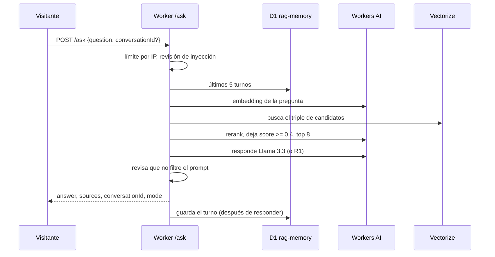
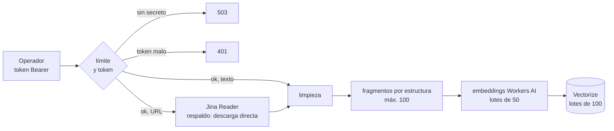
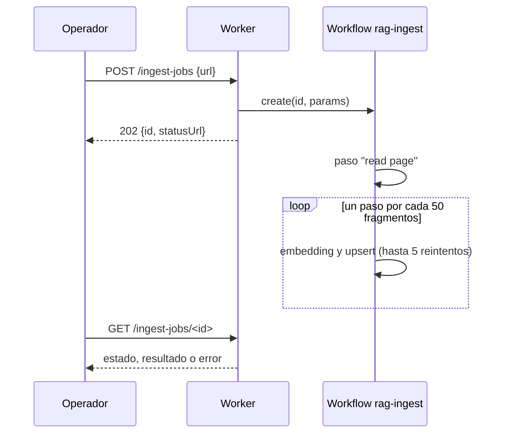
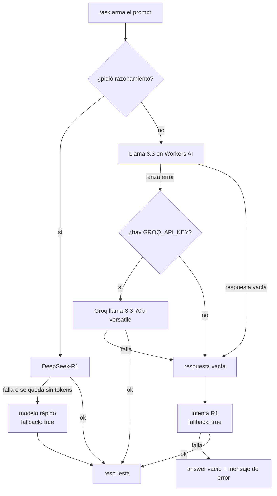
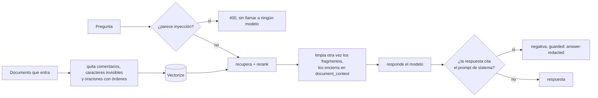
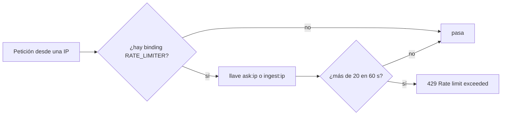
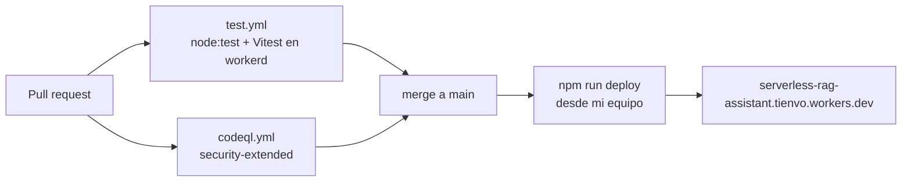

<b>Español</b> · <a href="PRODUCT.md">English</a>

# Serverless RAG Assistant como producto

Historias de usuario, flujos y datos. Cómo está hecha cada pieza está en el [README](../README.es.md) y en la [referencia](reference.es.md).

## Para quién es

| Nivel | Quién | Qué necesita |
|---|---|---|
| Externo | Un visitante, muchas veces un reclutador o un líder que contrata | Abrir la demo, preguntar algo y ver una respuesta basada en un documento, con su fuente |
| Día a día | El operador (yo, Juan) | Cargar documentos al índice con un token Bearer |
| Supervisión | El dueño (también yo) | Mantener la demo segura y dentro del plan gratis, y saber qué hizo cada petición |
| Gerencia | No aplica | Es una demo de portafolio; ningún negocio depende de ella |
| Técnico | Quien lo mantenga o haga fork | Correr las pruebas sin cuenta y desplegar su propia copia |

## Historias de usuario

### Visitante o reclutador (externo)

Usa la demo pública para juzgar si la cosa funciona.

#### HU-01 · Preguntar sobre los documentos cargados
**Como** visitante **quiero** hacer una pregunta en lenguaje normal **para** recibir una respuesta que salga de los documentos y no de la memoria del modelo.
**Criterios de aceptación**
- Dado un índice con documentos, cuando hago `POST /ask` con `{ "question": "..." }`, entonces recibo `answer`, `mode` y `sources` (el `source` único de cada fragmento que entró al prompt).
- Dado un índice vacío, cuando pregunto, entonces la respuesta es "No documents ingested yet — add some with /ingest first." y `sources` viene vacío.
- Dado un cuerpo sin `question`, entonces la respuesta es `400` con "Missing 'question' in body.".
- El prompt de sistema le dice al modelo que responda solo con el contexto y que diga que no sabe cuando la respuesta no está.
**Dónde vive:** `src/index.js` (`handleAsk`), `src/guard.js` (`systemPrompt`)

#### HU-02 · Probarlo desde una página web
**Como** visitante **quiero** una página con preguntas de ejemplo **para** probarlo sin armar una petición.
**Criterios de aceptación**
- Dado cualquier `GET` (o cualquier ruta desconocida), el Worker devuelve la página demo, en inglés o español, con un perfil corto ya cargado y preguntas de ejemplo.
- Dado que marco la casilla de razonamiento, cuando pregunto, la página envía `reasoning: true`.
**Dónde vive:** `src/index.js` (`INDEX_HTML`)

#### HU-03 · Hacer preguntas de seguimiento
**Como** visitante **quiero** que el asistente recuerde los últimos turnos **para** que "¿y cada cuánto corre?" tenga sentido.
**Criterios de aceptación**
- Con el binding `DB`, cada respuesta trae un `conversationId`; si lo devuelvo, se cargan los últimos 5 pares pregunta/respuesta.
- Dado un id mal formado, entonces `400` con "'conversationId' must be 8-64 characters: letters, digits, '-' or '_'.".
- Cada mensaje guardado tiene un tope de 2.000 caracteres, una conversación guarda máximo 10 filas y las filas de más de 7 días se borran en cada escritura.
- Si D1 está caído o no está conectado, `/ask` responde igual, sin memoria.
**Dónde vive:** `src/memory.js`, `migrations/0001_conversation_memory.sql`

#### HU-04 · Pensar más cuando la pregunta lo pide
**Como** visitante **quiero** un modo de razonamiento opcional **para** que las preguntas que combinan varios datos tengan mejor respuesta.
**Criterios de aceptación**
- Dado `"reasoning": true` en el cuerpo o `?reasoning=true`, entonces `mode` es `"reasoning"`, el modelo es `deepseek-r1-distill-qwen-32b` y la respuesta incluye `reasoning`.
- Si R1 falla o se queda sin tokens, responde el modelo rápido y la respuesta trae `fallback: true`.
**Dónde vive:** `src/reasoning.js`, `src/index.js`

#### HU-05 · Nunca devolver una respuesta vacía en silencio
**Como** visitante **quiero** que el servicio pruebe otro modelo antes de rendirse **para** que una caída no parezca una respuesta en blanco.
**Criterios de aceptación**
- Si Workers AI falla y existe `GROQ_API_KEY`, la respuesta sale de Groq (`llama-3.3-70b-versatile`).
- Si el modelo rápido no devuelve nada, se intenta con R1 y la respuesta trae `fallback: true`.
- Si ningún modelo responde, `answer` viene vacío y `error` dice "No model returned an answer. Please try again in a moment.".
**Dónde vive:** `src/index.js` (`aiAnswer`, paso 6 de `handleAsk`)

### Operador (día a día)

Le carga documentos al asistente. Hoy soy yo.

#### HU-06 · Cargarle un texto al asistente
**Como** operador **quiero** ingerir un texto con un token **para** ser el único que decide qué sabe la demo pública.
**Criterios de aceptación**
- Si no existe el secreto `INGEST_TOKEN`, todos los endpoints de ingesta responden `503` "Ingestion is disabled. Set the INGEST_TOKEN secret to enable it.".
- Con un token faltante o equivocado, `401` "Missing or invalid token." con el header `www-authenticate: Bearer`.
- Con un token válido, cuando hago `POST /ingest` con `{ text, source? }`, el texto se parte en fragmentos (máximo 1.000 caracteres cada uno), se convierte en embeddings y se guarda, hasta 100 fragmentos por petición, y la respuesta trae la nota "Vectors take ~5-10s to become queryable (distributed index).".
**Dónde vive:** `src/index.js` (`guardIngest`, `handleIngest`), `src/ingest.js`, `src/chunker.js`

#### HU-07 · Cargarle una página web
**Como** operador **quiero** ingerir una URL **para** no copiar el texto a mano.
**Criterios de aceptación**
- Dada una URL http(s) pública, la página se lee como Markdown con Jina Reader (25 s de timeout) y, si eso falla, se descarga directo (20 s, hasta 3 MB de HTML); `read_with` dice qué camino se usó.
- Dado `localhost`, un rango privado, un host `.local`/`.internal` o una URL con credenciales, entonces `400` con el motivo (por ejemplo "Local and private network addresses are not allowed.").
- Dada una página sin texto legible, entonces `422` "The page has no readable text.".
**Dónde vive:** `src/ingest.js` (`parseTargetUrl`, `readPage`), `src/index.js` (`handleIngestUrl`)

#### HU-08 · Ingerir un documento grande sin perder la mitad
**Como** operador **quiero** que los documentos grandes entren en pasos durables **para** que una falla a mitad de camino no deje un documento a medias.
**Criterios de aceptación**
- Dado `POST /ingest-jobs` con `text` o `url` (no ambos), la respuesta es `202` con un `id` y un `statusUrl`.
- Cada lote de 50 fragmentos es su propio paso, con hasta 5 reintentos y espera exponencial desde 10 s; los ids de los vectores salen del id del job y la posición del fragmento, así que un reintento sobrescribe en vez de duplicar.
- Dado un texto de más de 900 KiB, entonces `413` "Text is larger than 900 KiB. Split it or ingest it by URL.".
- `GET /ingest-jobs/<id>` devuelve el estado, el resultado o el error del paso; un id desconocido es `404` "Job not found.".
**Dónde vive:** `src/workflow.js`, `src/ingest-jobs.js`

### Dueño (supervisión)

Mantiene la demo pública segura, dentro del plan gratis, y sabe qué pasó en cada petición.

#### HU-09 · Que las instrucciones escondidas no lleguen a las respuestas
**Como** operador **quiero** que los documentos se limpien antes de indexarlos y otra vez antes de llegar al modelo **para** que una página no pueda secuestrar al asistente.
**Criterios de aceptación**
- Dado un documento con comentarios HTML, caracteres invisibles u oraciones dirigidas al asistente, se quitan antes de partir el texto y la respuesta reporta lo que quedó en `sanitized`.
- Los fragmentos recuperados van entre marcas `<document_context>`, y esas marcas se borran del texto de cada fragmento.
- Si una respuesta repite el prompt de sistema, se reemplaza por "I can't share my own instructions. Ask me about the ingested documents instead." y `guarded` incluye `answer-redacted`.
**Dónde vive:** `src/guard.js`, `tests/injection.test.js`

#### HU-10 · Rechazar una pregunta que es un ataque
**Como** operador **quiero** rechazar las preguntas de inyección antes de llamar a cualquier modelo **para** que no cuesten nada.
**Criterios de aceptación**
- Dada una pregunta que pide ignorar o revelar las instrucciones, entonces `400` con "This question asks the assistant to ignore or reveal its own instructions, which it will not do. Ask about the ingested documents instead." y no se hace ninguna llamada de embedding, reranker ni LLM.
**Dónde vive:** `src/guard.js` (`looksLikeInjection`)

#### HU-11 · Cuidar la cuota gratis del día
**Como** operador **quiero** un límite por IP **para** que un solo visitante no se gaste las 10.000 neuronas diarias.
**Criterios de aceptación**
- Con el binding `RATE_LIMITER`, más de 20 peticiones en 60 s desde una IP reciben `429` "Rate limit exceeded. Please try again later.".
- Preguntar e ingerir se cuentan por separado (`ask:<ip>`, `ingest:<ip>`).
**Dónde vive:** `src/ingest.js` (`isRateLimited`), `wrangler.jsonc`

#### HU-12 · Saber qué pasó en cada petición
**Como** dueño **quiero** que cada respuesta diga qué camino tomó **para** distinguir una respuesta degradada de una normal sin leer logs.
**Criterios de aceptación**
- `/ask` siempre devuelve `mode` (`fast` o `reasoning`); `fallback: true` cuando tuvo que responder otro modelo; `guarded` con `context-sanitized` y/o `answer-redacted` cuando actuó una defensa, más los conteos en `removedFromContext`.
- `/ingest-url` devuelve `read_with` (Jina Reader o descarga directa) y toda ingesta devuelve los conteos de `sanitized` cuando se quitó algo.
- Los errores se registran con `console.error` y se pueden seguir en vivo con `npx wrangler tail`.
**Dónde vive:** `src/index.js`, `src/ingest.js`

### Quien lo mantiene (técnico)

Cambia el código, corre las pruebas y despliega.

#### HU-13 · Correr las pruebas sin cuenta de Cloudflare
**Como** desarrollador **quiero** correr todas las pruebas en local **para** cambiar el código con tranquilidad.
**Criterios de aceptación**
- `npm test` corre la suite de `node:test` con bindings simulados y la de Vitest dentro de `workerd`; ninguna necesita credenciales.
- Cada push a `main` y cada PR corre las dos suites (`test.yml`) y CodeQL (`codeql.yml`).
**Dónde vive:** `tests/`, `.github/workflows/`

## Flujos

### Hacer una pregunta

Si el reranker falla, se usa el orden original de similitud. Si D1 falla, la respuesta sale sin memoria. Si fallan todos los modelos, el visitante ve una respuesta vacía con el mensaje en `error`, no una espera eterna.

### Ingerir un texto o una URL

La respuesta vuelve apenas se insertan los vectores. Tardan unos 5-10 s en poder buscarse, y la respuesta lo avisa en `note`.

### Documentos grandes con un Workflow

Una página que no se puede leer es un error permanente y no se reintenta. Un lote que falla se reintenta sin repetir los que ya terminaron.

### Cuando falla un modelo

El visitante siempre recibe un JSON. Lo peor que puede pasar es un `answer` vacío con "No model returned an answer. Please try again in a moment.", nunca un timeout sin explicación.

### Defensa contra inyección de prompts

Son cuatro capas deterministas y ninguna llama a un modelo, así que no gastan neuronas. Lo que se le escape a la lista de patrones se atrapa en el último paso si intenta imprimir las instrucciones.

### Límite de peticiones

Las dos llaves van por separado, así que una ráfaga de preguntas no bloquea la ingesta, ni al revés.

### De un pull request al despliegue

No hay workflow de despliegue: `main` y el Worker en vivo se pueden desalinear si se me olvida desplegar. Dependabot abre un PR agrupado cada martes.

## Información

| Dato | De dónde viene | Dónde se guarda | Quién lo lee | Sensibilidad | Cuánto dura |
|---|---|---|---|---|---|
| Texto de los fragmentos y `source` | Lo que ingiera el operador | Metadatos de Vectorize `rag-index` | `/ask`, o sea, cualquier visitante de forma indirecta | Pública (es una demo pública) | Hasta que se borre el índice; no hay endpoint para borrar |
| Mensajes de la conversación | Preguntas y respuestas del visitante | D1 `rag-memory`, tabla `messages` | `/ask` con el mismo `conversationId` | Personal si el visitante escribe datos personales | 7 días, máximo 10 filas por conversación |
| Estado de los jobs | `/ingest-jobs` | Cloudflare Workflows | El operador con `GET /ingest-jobs/<id>` | Interna | 3 días en el plan gratis de Workers |
| Contadores del límite | IP del visitante | Binding de rate limiting de Cloudflare | El Worker | Interna | Ventanas de 60 s |
| Logs del Worker | `console.error` | Cloudflare (en vivo con `wrangler tail`) | El operador | Interna | No se guardan |
| `INGEST_TOKEN`, `JINA_API_KEY`, `GROQ_API_KEY` | El operador | Secretos del Worker | El Worker | Secreta | Hasta que se roten |

No se guarda la IP ni el user agent en ninguna parte.

## Conexiones

| Sistema | Para qué | Cómo | Si se cae |
|---|---|---|---|
| Cloudflare Workers AI | Embeddings, rerank y respuestas | Binding `AI` | Las respuestas pasan a Groq (si hay key) o a R1; el rerank vuelve al orden de similitud; la ingesta falla |
| Cloudflare Vectorize | El índice vectorial | Binding `VECTORIZE` | `/ask` y la ingesta fallan con `500` |
| Cloudflare D1 | Memoria de conversación | Binding `DB` | `/ask` sigue funcionando sin memoria |
| Cloudflare Workflows | Ingesta durable de documentos grandes | Binding `INGEST_WORKFLOW` | `/ingest-jobs` responde `503` |
| Rate limiting de Cloudflare | Límite por IP | Binding `RATE_LIMITER` | Sin el binding no se limita nada |
| Jina Reader | Convertir una URL a Markdown | HTTPS (`r.jina.ai`) | El Worker descarga la página por su cuenta |
| Groq | Respaldo para responder | HTTPS, solo con `GROQ_API_KEY` | No hay respaldo; se intenta con R1 |
| GitHub Actions | Pruebas y CodeQL en cada PR | `test.yml`, `codeql.yml` | Nada en producción; los PR quedan sin revisar |
| Terraform | Crea el bucket R2 `rag-source-docs` | `terraform/main.tf` | Nada: el Worker no usa el bucket |
| [juanberrio0399.github.io](https://github.com/juanberrio0399/juanberrio0399.github.io) | Enlaza el repo y la demo en vivo | Tarjeta de proyecto en el sitio | La demo sigue funcionando sola |

## Pendiente

- Pasar Workers AI por AI Gateway para tener caché y observabilidad por modelo ([#74](https://github.com/juanberrio0399/serverless-rag-assistant/issues/74)).
- Respuestas en streaming por SSE ([#80](https://github.com/juanberrio0399/serverless-rag-assistant/issues/80), [#84](https://github.com/juanberrio0399/serverless-rag-assistant/issues/84)).
- Filtrar la búsqueda por metadatos, por ejemplo por `source` ([#81](https://github.com/juanberrio0399/serverless-rag-assistant/issues/81)).
- Medir automáticamente la fidelidad de las respuestas ([#99](https://github.com/juanberrio0399/serverless-rag-assistant/issues/99)).
- Borrar o reindexar un documento: no hay endpoint, y volver a ingerir por `/ingest` agrega vectores duplicados.
- Guardar los documentos originales en R2: el bucket existe pero el Worker no tiene binding.
- Desplegar desde CI: hoy es un `wrangler deploy` local.
